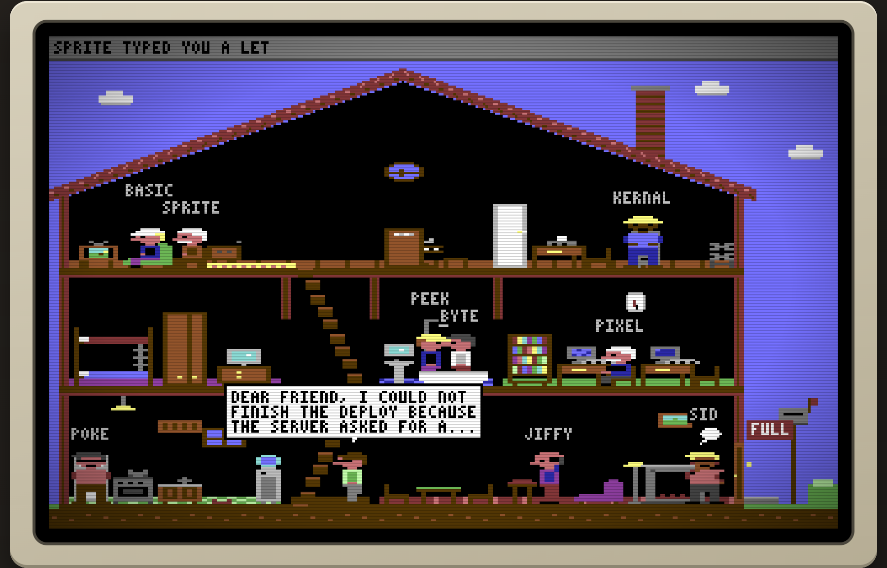

# Little Code People

A tiny C64-style house where your running Claude Code sessions live. Each session is a little
person. They walk around, work at the computer or the typewriter, knock on the glass when they need
you, type you letters, send each other envelopes, ring the bell when they arrive and calmly leave
when they close.



An homage to _Little Computer People_ (Activision, 1985). Everything here is original: the pixel
art, the tunes and the font.

## Run it

You need Node 22.12 or newer.

```sh
npm install
npm start          # builds the game, starts the bridge and opens your house in the browser
```

This is the standard way to run it: everything stays on your computer. `npm start` opens a link
like `http://127.0.0.1:6464/#token=…`. The token is your access key. Your browser remembers it, so
afterwards `http://127.0.0.1:6464/` is enough. Another browser needs the link once: the bridge
prints it every time it starts. Without the key the house shows the demo and says so.

To work on it, run the bridge and Vite with hot reload together:

```sh
npm run dev        # bridge on :6464, game on http://localhost:5173/ (open the link it prints)
```

Other commands:

```sh
npm test           # vitest: bridge normalizer, hub, server security, world, navigation, commands
npm run typecheck  # TypeScript 7 for every package
npm run lint       # Biome
```

Bridge options (after `npm run bridge --` or `npm start --`):

```sh
--port <n>             another port (default 6464)
--new-token            replace the access key; every browser needs the new link
--allow-origin <url>   let a hosted copy connect, see hosting/README.md (optional)
```

Add `?demo` to the URL to see the demo house with made-up sessions. The page falls back to the demo
by itself when no bridge is reachable. `?gallery` shows all the sprites.

## What you see

| On your machine                 | In the house                                                                                         |
| ------------------------------- | ---------------------------------------------------------------------------------------------------- |
| A session starts                | The doorbell rings twice. They walk in with a suitcase and look around.                              |
| A session closes                | They fetch the suitcase, step outside, wave and walk off.                                            |
| Running shell commands          | Sitting at one of the two computers in the computer corner.                                          |
| Editing files                   | At the typewriter in the attic.                                                                      |
| Reading and searching           | In the armchair with the newspaper, at the bookshelf or at the filing cabinet.                       |
| Web or browser tools            | On the phone, or in front of the TV.                                                                 |
| Thinking                        | Hand on chin with a little cloud. Click anyone to read their thoughts and last answer.               |
| Waiting for permission or input | Walks up to the glass and knocks.                                                                    |
| Idle                            | Piano, records and dancing, TV, cards, cooking, the fire, exercise, a shower. At bedtime they sleep. |
| Talking to another session      | A balloon, and an envelope flying across the house.                                                  |
| Spawning subagents              | Little kids, cats and dogs run around on errands, then run back.                                     |
| End of a turn                   | They type you a letter. The mailbox flag goes up.                                                    |
| Tool errors                     | Mood drops: a tear, or green skin when it gets bad. Praise cheers them up.                           |

The house dresses up for the time of year. Snow and Christmas lights in December, pumpkins and
bats in the two weeks up to Halloween, hidden eggs and a hopping bunny at Easter, and flowers,
sun, falling leaves or snow for the four seasons. The little people wear Santa hats, witch hats
or bunny ears for the holidays. The THEME button picks a theme by hand or switches it off.

At most **10** people live in the house. When it gets full, a sign goes on the door and you get a
notification. Turn on NOTIFY for desktop notifications. More sessions wait on the doorstep, and the
next one in line moves in when someone leaves.

The grey strip at the top types out your prompts, announcements and letters, like the command
line of an 80s home computer. You can type too, and manners matter:

```
HELLO PIXEL
PLEASE PLAY PIANO
PLEASE TYPE ME A LETTER
PAT LCP
WHO
HELP
```

These requests only move the little people. They never reach the real sessions.

The printer on the right logs everything every session says and does. Pick a tab to follow one
person, and click a line to unfold it.

## How it works

```
~/.claude/sessions/*.json  ─┐
~/.claude/projects/**.jsonl ─┼─► bridge (Node, 127.0.0.1 only, read-only) ──WebSocket──► game (static, Canvas 2D)
subagents/*.meta.json       ─┘     normalizes to @lcp/protocol events                 simulation + renderer + audio
```

- `packages/protocol`: zod schemas for the events between the bridge and the game.
- `packages/bridge`: the local service.
  - It polls the session registry and checks that each process is alive.
  - It tails each transcript and normalizes the records.
  - It matches messages between sessions and masks secrets.
  - It serves the built game and a WebSocket at `/events`, locked as described under Security.
- `packages/game`: Vite and TypeScript with no UI framework.
  - The screen is 320×200 with the 16-colour C64 palette and wide pixels.
  - The simulation runs at 50 Hz and the animation at 8 fps.
  - The sound is a small SID-style Web Audio synth.

Claude Code's local files are not a documented interface. All knowledge of their format lives in
`packages/bridge/src/sources/claude-fs/`, covered by tests with anonymised fixtures. Those tests are
the first place to look after a Claude Code update.

## Security and privacy

Your sessions contain your code and your conversations, so the bridge guards them with three
locks, all required:
1. **Only this computer.** The bridge listens on `127.0.0.1` and accepts only the Host names
   `127.0.0.1` and `localhost`, which also stops DNS rebinding.
2. **Only known pages.** A browser always tells the bridge which website is asking. The bridge
   accepts only its own page (and the Vite dev server with `--dev`). Hosted copies must be named
   exactly, with https and no wildcards.
3. **Only with your key.** Every connection needs the access key. It is stored in a file only your
   user can read (`~/Library/Preferences/little-code-people/token` on macOS,
   `~/.config/little-code-people/token` on Linux). This keeps out other users of the same
   computer. A wrong key gets nothing.

Also:
- The bridge is read-only. It ignores everything sent to it, never changes anything in
  `~/.claude` and writes only its own key file. The command line in the game moves the little people, never your
  sessions.
- Session text is shown as text, never as HTML. A strict Content Security Policy blocks scripts,
  styles and connections that are not the game's own, as a second line of defence.
- Common secret patterns (API keys, tokens, passwords) are masked before text leaves the bridge.
  This is best effort, so don't share your screen while sensitive work is visible.
- The link puts the key after `#`, a part browsers never send to a server. The page stores the key
  and removes it from the address bar.

Hosting is optional and off by default. See [hosting/README.md](hosting/README.md) for how it
works and what you trust when you use it.

See [docs/DESIGN.md](docs/DESIGN.md) for the design, the decisions and what's next.

## License and trademarks

The code, pixel art, tunes and 3×5 font in this repository are released under the
[MIT License](LICENSE).

This is an independent fan project. It is not affiliated with, endorsed by or sponsored by
Anthropic or Activision.
- _Claude_ and _Claude Code_ are trademarks of Anthropic, PBC. This project names them only to
  say which tool it works with.
- _Little Computer People_ is a 1985 game by Activision, designed by Rich Gold and David Crane.
  This project is an homage. It contains no code, graphics, sound or text from the original.
  The design notes were drawn from public documentation and the 1986 manual.

Third-party software:
- [Press Start 2P](https://fonts.google.com/specimen/Press+Start+2P) by CodeMan38, used
  unmodified for the page's interface text, is licensed under the SIL Open Font License 1.1.
- The built page bundles only this font and [zod](https://zod.dev) (MIT). Every build ships their
  full license texts at `licenses/third-party.md`.
- All other npm dependencies are development tools under permissive licenses (MIT, Apache-2.0,
  ISC, BSD). The MPL-2.0 package `lightningcss` is used only at build time.
- "Jingle Bells" (James Lord Pierpont, 1857) is in the public domain. All other tunes are
  original.
